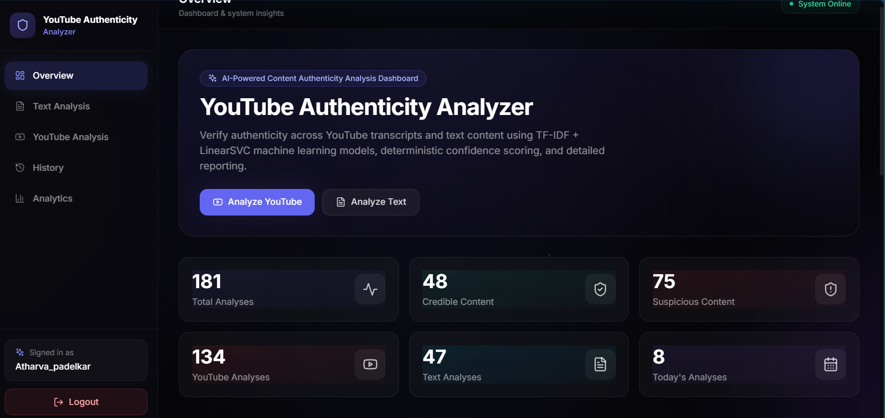
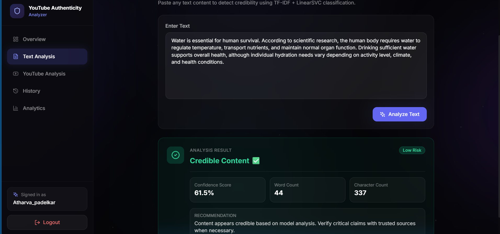
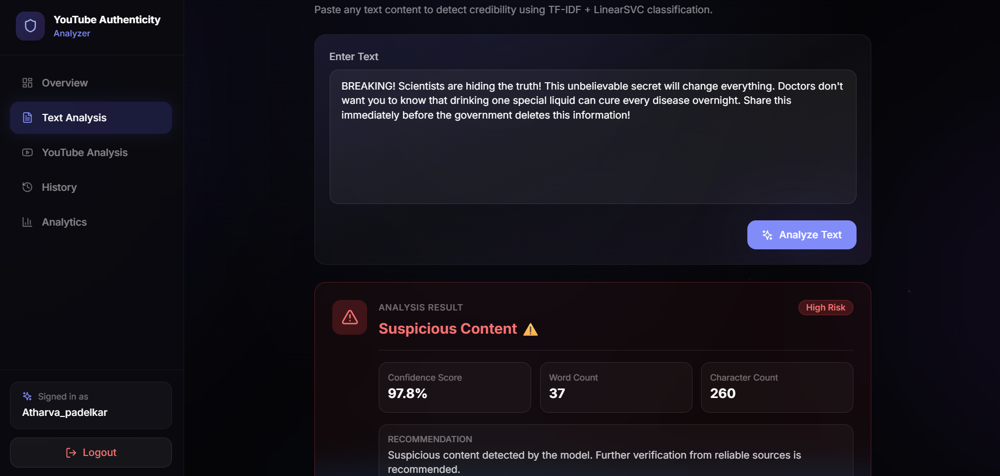
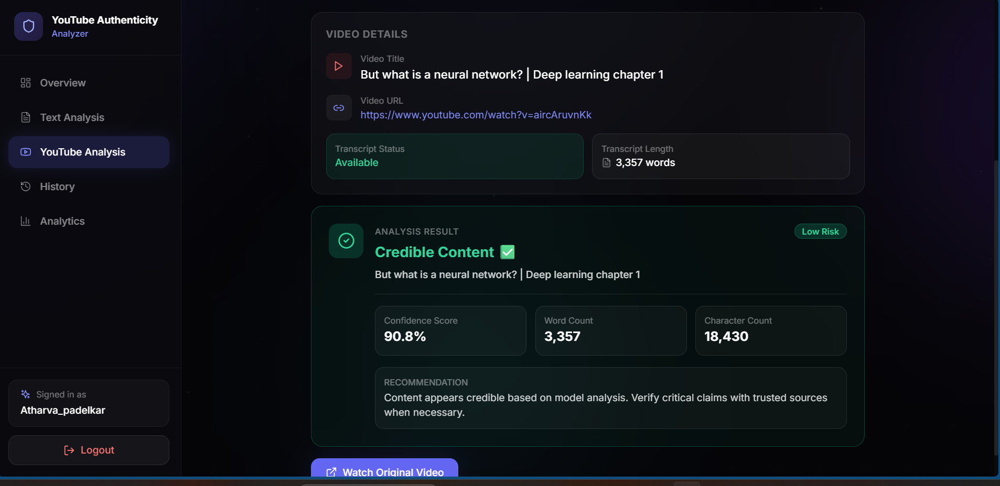
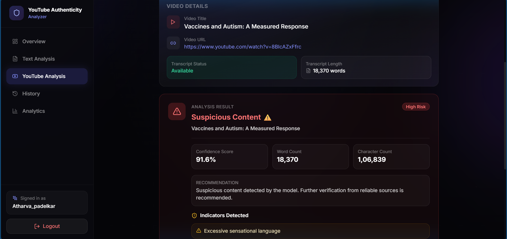
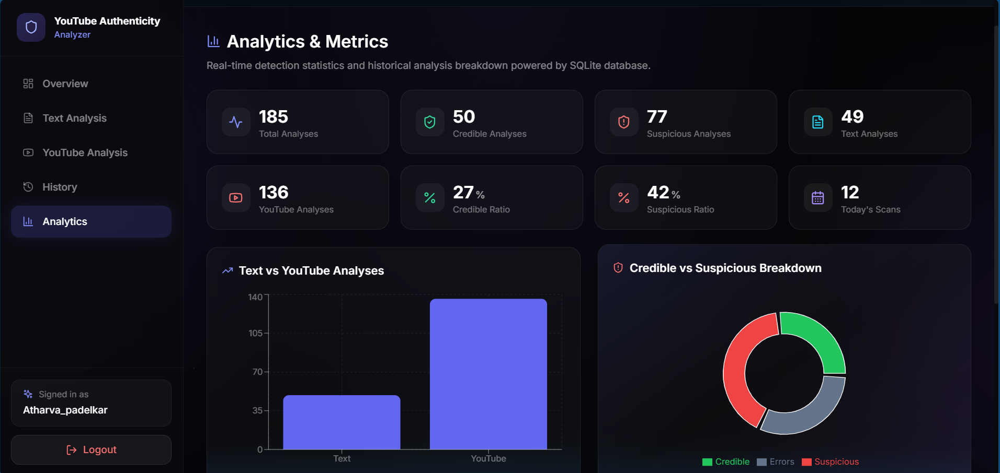

# YouTube Authenticity Analyzer

An ML-powered web application that analyzes text and YouTube video transcripts to estimate content credibility.

## Features

- Text-based credibility analysis
- YouTube video transcript analysis
- Automatic speech transcription fallback for videos without captions
- Credibility prediction with confidence score
- Analysis history and dashboard
- PDF analysis reports
- User authentication

## Tech Stack

**Frontend:** React, Vite, Tailwind CSS  
**Backend:** Python, FastAPI  
**Machine Learning:** Scikit-learn, TF-IDF  
**Database:** SQLite  
**YouTube Processing:** Transcript extraction, Whisper, yt-dlp

## Project Structure

    Dataset/
    ├── backend/
    ├── frontend/
    ├── model_v4.pkl
    ├── vectorizer_v4.pkl
    ├── requirements.txt
    └── README.md

## Getting Started

### 1. Clone the repository

    git clone https://github.com/atharva1429/Youtube-Authenticity-Analyzer.git
    cd Youtube-Authenticity-Analyzer/Dataset

### 2. Set up Python

    python -m venv venv

Activate the environment on Windows:

    venv\Scripts\activate

Install backend dependencies:

    pip install -r requirements.txt

### 3. Start the backend

Follow the backend entry point and configuration in the project source code.

### 4. Start the frontend

Open another terminal:

    cd frontend
    npm install
    npm run dev

## Important Note

This project estimates content credibility using a machine learning model. Its predictions are not definitive proof that a claim is true or false. Results should be independently verified.

## License

MIT

## Screenshots

### Main Dashboard

### Text Analysis — Example 1

### Text Analysis — Example 2

### YouTube Analysis — Example 1

### YouTube Analysis — Example 2

### Analytics Dashboard

